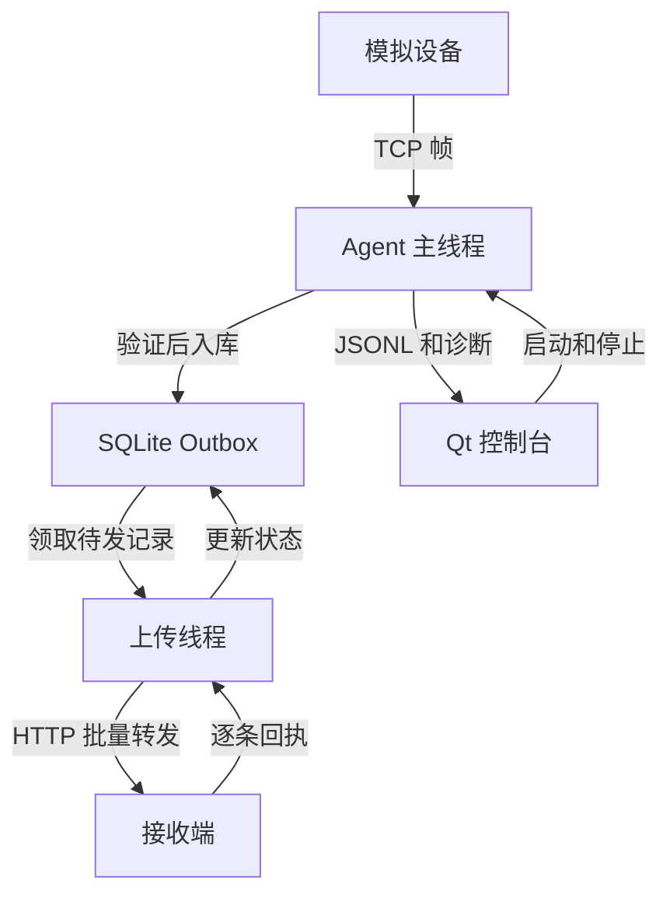

# EdgeRelay

基于 **C++17、Linux、SQLite、libcurl 和 Qt Widgets** 的设备遥测采集与可靠转发示例工程。

Agent 通过自定义 TCP 帧接收测值，完成解码与验证后写入本地 SQLite Outbox，再由独立上传线程批量转发到 HTTP 接收端。Qt 控制台负责管理 Agent 子进程，并展示运行状态、连接活动和近期事件。

默认演示使用自建模拟数据和本地接收端，无需真实传感器或外部业务后端。

## 功能

- **TCP 采集**：非阻塞 Socket/poll、多连接、流式解码，处理分片、多帧和异常输入。
- **本地持久化**：SQLite Outbox、稳定事件 ID、本地去重和身份冲突检查。
- **批量转发**：逐条回执核验、失败重试、遗留 SENDING 恢复和未确认事件补传。
- **运行观察**：JSONL 状态、TCP 连接活动、原始输入录制和业务计数。
- **管理命令**：配置检查、仅补传模式、持有单实例锁的离线 DEAD 导出。
- **Qt 控制台**：启动、正常停止、强制终止、窗口关闭回收，以及有界事件历史和诊断展示。
- **自动验收**：协议、存储、上传、进程管理、故障恢复及 GUI 模型测试。

## 架构



主线程负责采集、入库和状态采样；上传线程使用独立数据库连接。控制台通过 QProcess 管理 Agent，不共享业务数据库连接。

对已入库事件进行失败重试，接收端按事件 ID 去重。容量拒绝、内容冲突、未确认消息和 DEAD 记录分别处理和统计。

## 环境

已验证环境为 **Ubuntu 24.04、C++17、Qt 6.11.0**。核心 CLI 可以在关闭 GUI 的情况下独立构建。

| 依赖 | 工程要求 |
| --- | --- |
| CMake | ≥ 3.22 |
| C++ 编译器 | 支持 C++17 |
| nlohmann_json | ≥ 3.10 |
| yaml-cpp | ≥ 0.8 |
| libcurl | ≥ 7.62 |
| SQLite3 | ≥ 3.11.0 |
| GoogleTest | 构建自动测试时需要 |
| Python 3 | 测试和辅助脚本使用；源码打包验收脚本需要 3.12+ |
| Qt6 Core、Widgets | 可选，仅 GUI 需要 |

## 快速开始

克隆仓库并进入项目根目录。以下以 Ubuntu 24.04 为例。

### 1. 安装核心依赖

```bash
sudo apt update
sudo apt install -y \
  build-essential cmake python3 \
  libcurl4-openssl-dev libsqlite3-dev libyaml-cpp-dev \
  nlohmann-json3-dev libgtest-dev
```

`nlohmann-json3-dev` 和 `libgtest-dev` 位于 Ubuntu universe 软件源。包信息可参考 [yaml-cpp](https://packages.ubuntu.com/noble/libyaml-cpp-dev)、[nlohmann_json](https://packages.ubuntu.com/noble/nlohmann-json3-dev) 和 [GoogleTest](https://packages.ubuntu.com/noble/libgtest-dev)。

### 2. 构建并测试 CLI

```bash
(
  set -euo pipefail
  export PATH=/usr/bin:/bin
  unset LD_LIBRARY_PATH LD_PRELOAD LIBRARY_PATH CMAKE_PREFIX_PATH

  /usr/bin/cmake -S . -B build/core \
    -DCMAKE_BUILD_TYPE=Debug \
    -DCMAKE_CXX_COMPILER=/usr/bin/g++ \
    -DPython3_EXECUTABLE=/usr/bin/python3 \
    -DEDGE_BUILD_GUI=OFF \
    -DBUILD_TESTING=ON

  /usr/bin/cmake --build build/core --parallel 2
  /usr/bin/ctest --test-dir build/core \
    --output-on-failure --no-tests=error
)
```

检查配置：

```bash
./build/core/edge-agent --config config/release.yml --check-config
```

### 3. 本地演示

所有终端保持在项目根目录。

终端 A：启动模拟 HTTP 接收端。

```bash
mkdir -p run/receiver
/usr/bin/python3 scripts/mock_http_receiver.py \
  --bind 127.0.0.1 \
  --port 18080 \
  --db "$PWD/run/receiver/receiver.db" \
  --mode normal
```

终端 B：启动 Agent。

```bash
./build/core/edge-agent --config config/release.yml --run
```

终端 C：发送一条模拟温度事件。每次执行创建新的输入会话。

```bash
/usr/bin/python3 - <<'PY'
import json
import socket
import struct
import time
import uuid

event = {
    "schema_version": 1,
    "device_id": "demo_sensor",
    "session_id": str(uuid.uuid4()),
    "sequence": 1,
    "observed_at_ms": time.time_ns() // 1_000_000,
    "metric": "temperature",
    "value": 23.5,
    "unit": "degC",
}
payload = json.dumps(event, separators=(",", ":")).encode("utf-8")
packet = b"ETLM" + struct.pack("!I", len(payload)) + payload
with socket.create_connection(("127.0.0.1", 19090), timeout=5) as client:
    client.sendall(packet)
print("Sent:", event["device_id"], event["session_id"], event["sequence"])
PY
```

观察 Agent 的入库和上传输出，或查看 `run/release-agent/status.json`。接收端确认后，上传 ACK 计数增加，积压逐步清空。

结束时先在终端 B 使用 Ctrl+C 正常停止 Agent，再停止接收端。

## 常用命令

```bash
# 帮助和配置检查
./build/core/edge-agent --help
./build/core/edge-agent --config config/release.yml --check-config

# 结构化状态及事件展示输出
./build/core/edge-agent --config config/release.yml --run --events-jsonl

# 停止同库 Agent 后，仅处理已有积压
./build/core/edge-agent --config config/release.yml --drain-only --jsonl

# 停止同库 Agent 后，离线导出 DEAD；目标文件不能已存在
mkdir -p run/exports
./build/core/edge-agent --config config/release.yml \
  --export-dead "$PWD/run/exports/dead.jsonl"
```

`--data-dir` 同时覆盖数据库、录制和状态路径；补传和导出应沿用采集时的路径覆盖。DEAD 不计入 backlog，因此仅补传结束后 unacked 仍可能非零。

## Qt 控制台

额外安装 Qt6 后，可构建 `edge-console`。已验证 Qt 6.11.0；具体配置和构建命令见 [运行说明](docs/RUNNING.md#gui-构建)。

GUI 中选择 Agent 程序和配置文件。使用脚本生成的独立配置时，数据目录输入框留空，避免覆盖该会话的数据路径。

完整的 30 条唯一事件演示及录制核对见 [演示流程](docs/DEMO.md)。

## 验证记录

| 检查点 | 已记录结果 |
| --- | --- |
| 2026-11-25 功能代码构建 | 核心 531 项、控制台 151 项通过，均无跳过 |
| 固定事件场景 | 1000 条唯一事件一致性验收通过 |
| 三设备持续运行 | 30 分钟、27000 条唯一事件，最终全部 ACKED |
| 管理命令 | 空积压、混合积压、RETRY 等待、停止恢复及带锁导出通过 |
| 源码独立构建 | 源码包换目录解压后完成构建及测试，GUI 可正常启动、停止和关闭 |

这些是已记录的检查点，不是 GitHub CI 状态。持续运行使用固定输入负载，不代表最大吞吐量或任意环境下的长期稳定性。证据口径和范围见 [验证记录](docs/VALIDATION.md)。

## 项目结构

| 目录 | 内容 |
| --- | --- |
| `apps/agent/` | CLI、运行流程和离线管理入口 |
| `apps/console/` | Qt 窗口、子进程管理、协议解析及展示模型 |
| `include/edge/`、`src/` | 事件、验证、协议、网络、存储、上传、录制和状态模块 |
| `config/` | 示例配置 |
| `scripts/` | 模拟接收端、构建和专项验收工具 |
| `tests/` | C++ 单元测试、Python 集成测试及固定夹具 |
| `docs/` | 运行、演示、协议与验证文档 |

## 文档与范围

- [运行说明](docs/RUNNING.md)
- [演示流程](docs/DEMO.md)
- [协议概览](docs/PROTOCOL.md)
- [验证记录](docs/VALIDATION.md)
- [systemd 示例](docs/SYSTEMD.md)：仅提供模板，尚未部署验证。

当前验证以 Linux 本地模拟链路为主。Windows 服务、安装包及真实设备部署尚未纳入验证。构建目录和运行数据不应提交到仓库，可参考 [忽略规则示例](docs/GITIGNORE.example)。
